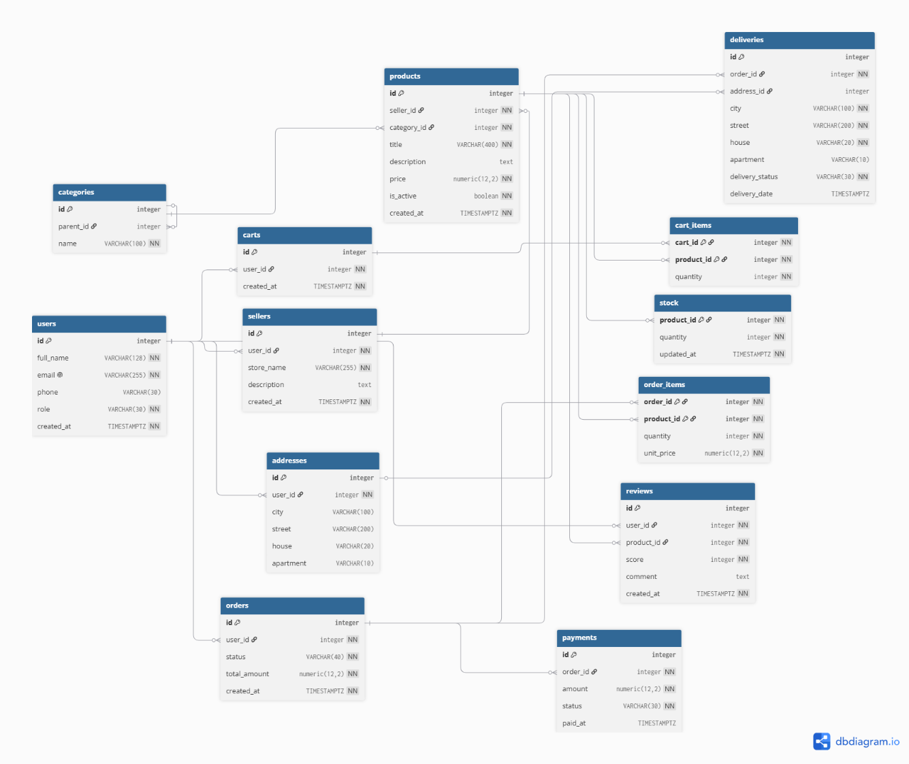
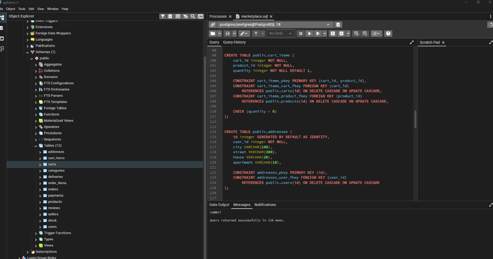

# Лабораторная работа №1 — Проектирование и создание структуры базы данных

**Дисциплина:** Математические основы баз данных 
**Предметная область:** Маркетплейс  
**СУБД:** PostgreSQL  
**Инструмент:** pgAdmin 4  
**Автор:** Провкин Алексей Сергеевич, БВТ2502  
**Год:** 2026

## Содержание

1. [Цель работы](#цель-работы)
2. [Анализ предметной области](#1-анализ-предметной-области)
3. [ER-диаграмма и связи](#2-er-диаграмма-и-связи)
4. [Нормализация до 3НФ](#3-нормализация-до-3нф)
5. [Выбор первичных ключей](#4-выбор-первичных-ключей)
6. [Реализация схемы в PostgreSQL](#5-реализация-схемы-в-postgresql)
7. [Словарь данных](#6-словарь-данных)
8. [Воспроизводимый SQL-скрипт](#7-воспроизводимый-sql-скрипт)
9. [Вывод](#вывод)

## Цель работы

Спроектировать и реализовать структуру базы данных маркетплейса в PostgreSQL:

- проанализировать предметную область и определить бизнес-правила;
- построить ER-диаграмму не менее чем из 10 сущностей;
- реализовать связи «многие ко многим» и иерархическую самоссылку;
- привести схему к третьей нормальной форме (3НФ);
- создать таблицы и ограничения средствами SQL DDL;
- подготовить словарь данных и единый SQL-скрипт, воссоздающий схему с нуля.

## 1. Анализ предметной области

База данных описывает работу маркетплейса: регистрацию пользователей и продавцов, размещение товаров, формирование корзин и заказов, оплату, отзывы и доставку.

### 1.1. Основные сущности

| Сущность | Таблица | Назначение |
|---|---|---|
| Пользователи | `users` | Учётные записи покупателей и владельцев магазинов |
| Продавцы | `sellers` | Магазины и их владельцы |
| Категории | `categories` | Иерархический классификатор товаров |
| Товары | `products` | Товарные карточки с продавцом и категорией |
| Складские остатки | `stock` | Доступное количество каждого товара |
| Корзины | `carts` | Корзины пользователей |
| Позиции корзины | `cart_items` | Товары и их количество в корзинах |
| Заказы | `orders` | Оформленные покупки |
| Позиции заказа | `order_items` | Состав заказов, связь заказов и товаров |
| Платежи | `payments` | Информация об оплате заказов |
| Отзывы | `reviews` | Оценки и комментарии к товарам |
| Адреса | `addresses` | Адреса доставки пользователей |
| Доставки | `deliveries` | Сведения о доставке заказов |

**Итого: 13 сущностей.**

### 1.2. Бизнес-правила

1. У каждого товара ровно один продавец.
2. Заказ принадлежит одному покупателю и содержит хотя бы одну позицию.
3. Отзыв относится к конкретному товару и оставляется конкретным пользователем.
4. Продавец связан с одним пользователем — владельцем магазина.
5. Пользователь может иметь корзину; в корзине товары хранятся с указанием количества.
6. Один товар может находиться в нескольких корзинах.
7. Доставка осуществляется по одному адресу.
8. Заказ может содержать несколько товаров, а товар — входить в несколько заказов.
9. Пользователь может иметь несколько адресов доставки.
10. Каждый товар относится к одной категории.
11. Категория может иметь одну родительскую категорию и несколько дочерних.
12. Для каждого товара хранится складской остаток.
13. С заказом связан платёж, содержащий сведения об оплате.
14. Количество товара в позиции заказа или корзины строго положительно.
15. Цена товара и сумма заказа не могут быть отрицательными.
16. Один пользователь может оставить только один отзыв на конкретный товар.
17. Один пользователь может владеть только одним магазином.

## 2. ER-диаграмма и связи



Диаграмма содержит **13 таблиц**, включая два примера связей **M:N**, реализованных ассоциативными таблицами:

| Связь | Ассоциативная таблица | Смысл |
|---|---|---|
| `orders` ↔ `products` | `order_items` | Один заказ содержит несколько товаров; товар встречается в разных заказах |
| `carts` ↔ `products` | `cart_items` | В корзине несколько товаров; товар встречается в разных корзинах |

**Иерархическая связь:** `categories.parent_id → categories.id` — категория ссылается на другую запись той же таблицы. Так формируется дерево категорий.

Дополнительно `stock.product_id` связывает запись складского остатка с товаром по схеме **1:1**.

## 3. Нормализация до 3НФ

### 3.1. Пример денормализованной таблицы

Рассмотрим условную таблицу, совмещающую информацию о товарах, продавцах и категориях:

```text
products_flat (
    product_id,
    title,
    price,
    seller_id,
    store_name,
    seller_email,
    category_id,
    category_name
)
```

В такой таблице возникают транзитивные зависимости:

```text
product_id → seller_id   → store_name, seller_email
product_id → category_id → category_name
```

Атрибуты продавца и категории зависят не непосредственно от идентификатора товара, а от других неключевых атрибутов, что нарушает 3НФ.

### 3.2. Аномалии до нормализации

| Аномалия | Пример |
|---|---|
| **Обновления** | При переименовании магазина приходится изменять запись каждого его товара |
| **Вставки** | Нельзя зарегистрировать продавца, пока у него нет товаров |
| **Удаления** | При удалении последнего товара можно потерять сведения о продавце |

### 3.3. Устранение аномалий

Данные разделены на самостоятельные таблицы:

- `sellers (id, user_id, store_name, ...)` — сведения о продавцах;
- `categories (id, parent_id, name)` — сведения о категориях;
- `products (..., seller_id, category_id, ...)` — сведения о товарах с внешними ключами.

Таким образом, сведения о продавце и категории не дублируются внутри каждой карточки товара.

| Аномалия | Решение после нормализации |
|---|---|
| Обновления | Информация о магазине меняется в одном месте — `sellers` |
| Вставки | Продавца или категорию можно создать без товаров |
| Удаления | Удаление последнего товара не удаляет запись продавца |

Схема приведена к **третьей нормальной форме (3НФ)**: неключевые атрибуты не имеют транзитивных зависимостей от ключа в рассмотренном разбиении.

В order_items.unit_price сохраняется цена товара на момент оформления заказа. В таблице deliveries адрес хранится посредством внешнего ключа address_id, а факт завершения доставки фиксируется флагом is_delivered.

## 4. Выбор первичных ключей

Для большинства таблиц используются числовые **суррогатные ключи** (`id`), создаваемые через `GENERATED BY DEFAULT AS IDENTITY`.

Причины выбора:

- естественные идентификаторы, например email или название магазина, могут изменяться;
- числовые ключи компактны и удобны для индексов и внешних ключей;
- идентификатор записи остаётся стабильным при изменении остальных данных.

### Исключения

| Таблица | Первичный ключ | Обоснование |
|---|---|---|
| `order_items` | Составной ключ из идентификаторов заказа и товара | Исключает повторение пары «заказ — товар» |
| `cart_items` | Составной ключ из идентификаторов корзины и товара | Исключает повторение пары «корзина — товар» |
| `stock` | `product_id` | Одному товару соответствует одна запись об остатках; отдельный `id` избыточен |

## 5. Реализация схемы в PostgreSQL

Схема реализована в **PostgreSQL** через SQL DDL. Для выполнения и проверки использовался **pgAdmin 4**.

При создании таблиц применены:

| Механизм | Назначение |
|---|---|
| `PRIMARY KEY` | Уникальная идентификация строк |
| `FOREIGN KEY` | Поддержание ссылочной целостности |
| `NOT NULL` | Обязательные значения |
| `UNIQUE` | Запрет недопустимых повторений |
| `CHECK` | Проверка допустимых значений и диапазонов |
| `DEFAULT` | Значения по умолчанию |
| `ON DELETE` / `ON UPDATE` | Правила обработки изменений связанных записей |

Для запуска скрипта в pgAdmin 4 используется **Tools → Query Tool**, затем выполнение SQL-команд.



## 6. Словарь данных

Для всех 13 таблиц составлен отдельный словарь данных с описанием:

- названий столбцов;
- типов данных;
- ограничений;
- назначения каждого поля.

В исходном отчёте словарь хранится как отдельный Markdown-файл `словарь_данных.md` в папке лабораторной работы. Он не включён в данный отчёт и должен быть добавлен в репозиторий отдельно.

## 7. Воспроизводимый SQL-скрипт

Все DDL-команды объединены в **один SQL-скрипт**. Перед созданием таблиц используются команды вида:

```sql
DROP TABLE IF EXISTS ... CASCADE;
```

Благодаря этому повторный запуск скрипта создаёт структуру базы данных заново.

> **Внимание:** пересоздание схемы через `DROP TABLE` удаляет существующие таблицы и их данные. Такой скрипт предназначен для учебной или тестовой базы.

Сам SQL-скрипт в исходном DOCX не приведён целиком, поэтому его необходимо хранить в репозитории отдельным `.sql`-файлом.

## Вывод

В ходе лабораторной работы была спроектирована и реализована структура базы данных маркетплейса в PostgreSQL.

**Результаты:**

- проанализирована предметная область и сформулированы 17 бизнес-правил;
- построена ER-диаграмма из 13 сущностей;
- реализованы связи «многие ко многим» и иерархическая самоссылка;
- схема приведена к 3НФ с сохранением цены товара на момент оформления заказа;
- определены первичные и внешние ключи, ограничения целостности;
- подготовлены словарь данных и единый воспроизводимый SQL-скрипт.

Полученная структура служит основой для хранения и обработки данных маркетплейса.
