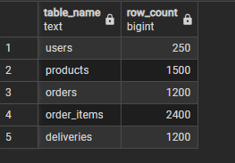
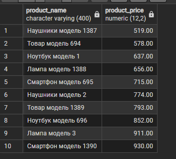
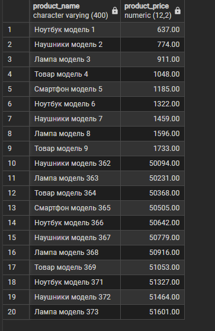
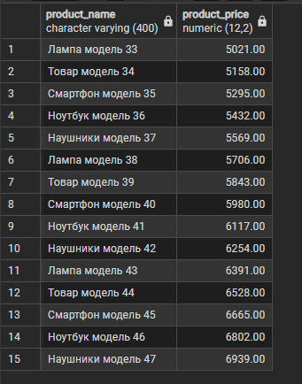
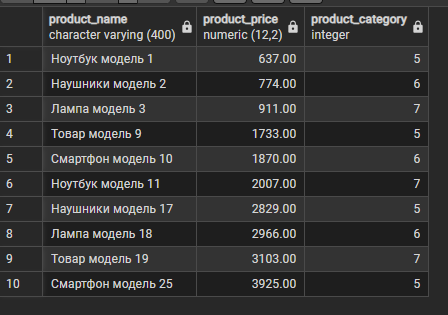
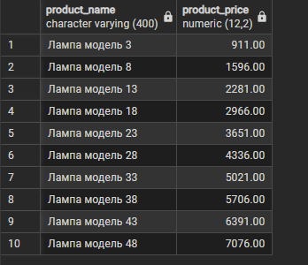
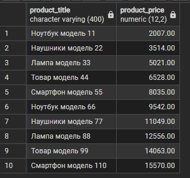
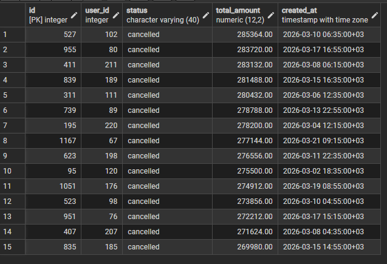
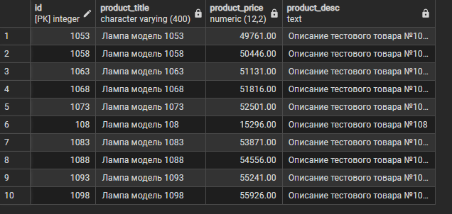

# Лабораторная работа №2 — Базовые SQL-запросы и фильтрация данных

**Дисциплина:** Математические основы баз данных  
**Предметная область:** Маркетплейс  
**СУБД:** PostgreSQL  
**Инструмент:** pgAdmin 4  
**Автор:** Провкин Алексей Сергеевич, БВТ2502  
**Год:** 2026

## Содержание

1. [Цель работы](#цель-работы)
2. [Наполнение базы данных тестовыми данными](#1-наполнение-базы-данных-тестовыми-данными)
3. [Выборка уникальных записей](#2-выборка-уникальных-записей)
4. [Фильтрация с использованием AND и OR](#3-фильтрация-с-использованием-and-и-or)
5. [Применение предикатов фильтрации](#4-применение-предикатов-фильтрации)
6. [Сортировка по нескольким столбцам](#5-сортировка-по-нескольким-столбцам)
7. [Постраничный вывод данных](#6-постраничный-вывод-данных)
8. [Документирование результатов](#7-документирование-результатов)
9. [Вывод](#вывод)

## Цель работы

Освоить базовые средства языка SQL для выборки, фильтрации, сортировки и ограничения количества возвращаемых записей в PostgreSQL.

В ходе лабораторной работы необходимо:

- наполнить ранее спроектированную базу данных маркетплейса согласованными тестовыми данными;
- изучить выборку уникальных записей с помощью `DISTINCT`;
- реализовать фильтрацию с логическими операторами `AND` и `OR`;
- применить предикаты `BETWEEN`, `IN`, `ILIKE` и `IS NULL`;
- выполнить сортировку по нескольким столбцам;
- реализовать постраничный вывод данных с помощью `LIMIT` и `OFFSET`;
- задокументировать назначение запросов и результаты их выполнения.

## 1. Наполнение базы данных тестовыми данными

Для выполнения лабораторной работы использовалась структура базы данных маркетплейса, созданная в лабораторной работе №1.

База данных содержит 13 взаимосвязанных таблиц, предназначенных для хранения информации о пользователях, продавцах, товарах, категориях, заказах, платежах, доставках и других сущностях.

### 1.1. Генерация тестовых данных

Для массового заполнения таблиц использовался SQL-скрипт, подготовленный с помощью генеративной языковой модели.

Генерация осуществлялась средствами PostgreSQL с использованием SQL-команд вставки и генерации значений.

При наполнении учитывались существующие ограничения целостности базы данных:

- `PRIMARY KEY` — уникальность первичных ключей;
- `FOREIGN KEY` — согласованность связанных записей;
- `UNIQUE` — ограничения уникальности;
- `NOT NULL` — обязательность заполнения полей;
- `CHECK` — допустимые значения атрибутов.

Для сохранения ссылочной целостности данные добавлялись в порядке зависимостей между таблицами.

Скрипт генерации хранится отдельно от запросов лабораторной работы.

Скрипт: [seed_AI_GENERATED.sql](seed_AI_GENERATED.sql). Запросы заданий 2–6: [queries.sql](queries.sql).

Перед заполнением скрипт очищает все 13 таблиц командой `TRUNCATE ... RESTART IDENTITY CASCADE`. Для повторного выполнения нужна учебная база со структурой из [лабораторной работы №1](../lab_work1/marketplace.sql).

### 1.2. Проверка наполнения

Скрипт генерации завершается запросом количества записей во всех 13 таблицах. Дополнительно выполнена проверка пяти основных таблиц; её результат представлен ниже и подтверждён скриншотом.

Фактическое наполнение проверенных таблиц:

| Таблица | Количество записей |
|---|---:|
| `users` | 250 |
| `products` | 1500 |
| `orders` | 1200 |
| `order_items` | 2400 |
| `deliveries` | 1200 |

Таким образом, подтверждено наличие не менее 1000 записей в таблицах товаров и заказов.

**Результат выполнения:**



```sql
SELECT 'users' AS table_name, COUNT(*) AS row_count FROM public.users
UNION ALL
SELECT 'products', COUNT(*) FROM public.products
UNION ALL
SELECT 'orders', COUNT(*) FROM public.orders
UNION ALL
SELECT 'order_items', COUNT(*) FROM public.order_items
UNION ALL
SELECT 'deliveries', COUNT(*) FROM public.deliveries;
```

## 2. Выборка уникальных записей

**Задача:** вывести названия и цены товаров без повторяющихся комбинаций значений, используя `DISTINCT` и псевдонимы столбцов.

### SQL-запрос

```sql
SELECT DISTINCT title AS product_name, price AS product_price
FROM public.products
ORDER BY product_price, product_name
LIMIT 10;
```

### Описание

Запрос обращается к таблице `products` и возвращает значения столбцов `title` и `price`.

Для повышения читаемости результата используются псевдонимы:

- `product_name` — название товара;
- `product_price` — цена товара.

Ключевое слово `DISTINCT` исключает повторяющиеся комбинации выбранных значений.

Сортировка производится сначала по цене товара, затем по его названию. Оператор `LIMIT 10` ограничивает результат десятью записями.

> Важно, что `DISTINCT` проверяет уникальность комбинации выбранных столбцов, а не каждого столбца независимо.

### Результат выполнения



В тестовых данных каждое название содержит уникальный номер модели, поэтому одинаковых комбинаций `title` и `price` нет. Запрос корректно использует `DISTINCT`, однако данный набор данных не демонстрирует фактическое удаление повторов.

## 3. Фильтрация с использованием AND и OR

**Задача:** выбрать активные товары с ценой менее 2000 или более 50000 условных денежных единиц.

### SQL-запрос

```sql
SELECT title AS product_name, price AS product_price
FROM public.products
WHERE is_active = TRUE AND ((price < 2000) OR (price > 50000))
LIMIT 20;
```

### Описание

Для фильтрации используется секция `WHERE`, содержащая несколько логических условий.

Условие `is_active = TRUE` ограничивает выборку активными товарами.

Оператор `OR` объединяет два условия цены: менее 2000 или более 50000.

Оператор `AND` требует, чтобы товар одновременно был активным и соответствовал хотя бы одному условию цены.

Круглые скобки явно задают порядок вычисления логических выражений. Результат ограничивается двадцатью записями.

### Результат выполнения



## 4. Применение предикатов фильтрации

В данном задании рассматриваются предикаты `BETWEEN`, `IN`, `ILIKE` и `IS NULL`, позволяющие задавать различные условия отбора записей.

### 4.1. BETWEEN — фильтрация по диапазону

**Задача:** вывести товары стоимостью от 5000 до 15000 включительно.

```sql
SELECT title AS product_name, price AS product_price
FROM public.products
WHERE price BETWEEN 5000 AND 15000
LIMIT 15;
```

**Описание:**

Предикат `BETWEEN` проверяет принадлежность значения указанному диапазону, включая обе его границы.

Условие `price BETWEEN 5000 AND 15000` *эквивалентно*:

```sql
price >= 5000 AND price <= 15000
```

Запрос возвращает не более 15 товаров, удовлетворяющих условию.

**Результат выполнения:**



### 4.2. IN — проверка принадлежности набору значений

**Задача:** выбрать товары, относящиеся к категориям смартфонов, ноутбуков и наушников.

```sql
SELECT title AS product_name, price AS product_price, category_id AS product_category
FROM public.products
WHERE category_id IN (5, 6, 7)
LIMIT 10;
```

**Описание:**

Предикат `IN` проверяет, входит ли значение столбца `category_id` в заданный набор идентификаторов.

В используемой базе данных:

| ID | Категория |
|---|---|
| 5 | Смартфоны |
| 6 | Ноутбуки |
| 7 | Наушники |

Перечисленные категории являются дочерними категориями раздела «Электроника».

Применение `IN` позволяет заменить несколько сравнений через `OR` более компактной записью.

**Результат выполнения:**



В генераторе название товара и категория задаются независимыми формулами, поэтому возможны смысловые несоответствия, например «Ноутбук модель 1» в категории 5 («Смартфоны»). Это не нарушает внешние ключи и не влияет на корректность фильтра `IN`, но требует доработки для реалистичного каталога.

### 4.3. ILIKE — поиск по строковому шаблону

**Задача:** найти товары, в названии которых содержится подстрока «лампа» без учёта регистра.

```sql
SELECT title AS product_name, price AS product_price
FROM public.products
WHERE title ILIKE '%лампа%'
LIMIT 10;
```

**Описание:**

Оператор `ILIKE` используется для поиска по строковому шаблону без учёта регистра букв.

Символ `%` обозначает произвольную последовательность символов, включая пустую. Таким образом, шаблон `%лампа%` допускает наличие любых символов до и после искомой подстроки.

В отличие от `ILIKE`, оператор `LIKE` выполняет сопоставление с учётом регистра.

Результат ограничивается десятью записями.

**Результат выполнения:**



### 4.4. IS NULL — поиск отсутствующих значений

**Задача:** вывести товары, для которых не указано описание.

```sql
SELECT title AS product_title, price AS product_price
FROM public.products
WHERE description IS NULL
LIMIT 10;
```

**Описание:**

Предикат `IS NULL` используется для определения строк, в которых значение указанного столбца отсутствует.

В SQL значение `NULL` не эквивалентно пустой строке и не может корректно проверяться обычным оператором равенства `=`.

Для поиска записей, имеющих значение в соответствующем поле, используется обратный предикат `IS NOT NULL`.

Условие `IS NULL` используется в этом задании, а `IS NOT NULL` — в задании 6.

**Результат выполнения:**



## 5. Сортировка по нескольким столбцам

**Задача:** вывести заказы, отсортированные по статусу в алфавитном порядке и по сумме в порядке убывания.

### SQL-запрос

```sql
SELECT id, user_id, status, total_amount, created_at
FROM public.orders
ORDER BY status ASC, total_amount DESC
LIMIT 15;
```

### Описание

Запрос обращается к таблице `orders`, содержащей сведения об оформленных заказах.

Для сортировки используется оператор `ORDER BY` с двумя критериями:

- `status ASC` — сортировка статусов по возрастанию;
- `total_amount DESC` — сортировка суммы заказа по убыванию.

Первый столбец имеет приоритет. Второй критерий используется при совпадении значений первого.

Таким образом, заказы с одинаковым статусом располагаются рядом, а внутри каждого статуса сортируются от большей суммы к меньшей.

Применение различных направлений сортировки демонстрирует возможность независимого управления порядком для каждого столбца.

### Результат выполнения



Первые 15 строк относятся к статусу `cancelled`, так как он идёт первым при сортировке. Скриншот показывает убывание суммы внутри этого статуса; переход между разными статусами в данный фрагмент не попал.

## 6. Постраничный вывод данных

**Задача:** реализовать вывод второй страницы каталога товаров с описанием, по десять записей на странице.

### SQL-запрос

```sql
SELECT id, title AS product_title, price AS product_price, description AS product_desc
FROM public.products
WHERE description IS NOT NULL
ORDER BY title ASC, price ASC, id ASC
LIMIT 10
OFFSET 10;
```

### Описание

Запрос выбирает товары, у которых поле `description` не содержит `NULL`.

Перед ограничением количества строк выполняется сортировка по названию, цене и идентификатору товара.

Использование `id` в качестве последнего критерия обеспечивает однозначный порядок строк при совпадении названия и цены.

Постраничный вывод реализуется операторами:

- `LIMIT 10` — максимальное количество записей на странице;
- `OFFSET 10` — количество записей, пропускаемых перед выводом.

Для расчёта смещения используется формула:

`OFFSET = (номер страницы - 1) × размер страницы`

При размере страницы 10 записей первая страница соответствует `OFFSET 0`, вторая — `OFFSET 10`, третья — `OFFSET 20`.

Реализованный запрос выводит вторую страницу отфильтрованного каталога товаров.

### Результат выполнения



## 7. Документирование результатов

Для каждого SQL-запроса в отчёте представлены:

- постановка задачи;
- текст SQL-запроса;
- назначение и объяснение используемых конструкций;
- скриншот фрагмента результата выполнения в pgAdmin 4.

В отчёт включены все девять скриншотов из папки `assets`: проверка количества записей в пяти основных таблицах и результаты запросов заданий 2–6. Они показывают таблицы результатов; текст запросов приведён рядом в отчёте.

В запросах заданий 3 и 4 используется `LIMIT` без `ORDER BY`: условия фильтрации определены, но состав и порядок показанного фрагмента при повторном выполнении не гарантируются. Для воспроизводимого вывода можно добавить `ORDER BY id` перед `LIMIT`.

Все запросы предназначены для чтения данных и не изменяют содержимое таблиц.

SQL-скрипт генерации данных и запросы лабораторной работы сохраняются отдельно для возможности повторного выполнения.

## Вывод

В ходе лабораторной работы №2 были изучены и практически применены базовые средства языка SQL для работы с данными в PostgreSQL.

**Результаты:**

- выполнено массовое заполнение 13 таблиц базы данных маркетплейса согласованными тестовыми данными;
- создано 1500 записей о товарах и 1200 записей о заказах, что соответствует указанным требованиям; количество записей подтверждено запросом подсчёта и скриншотом его результата;
- освоено использование `SELECT DISTINCT` для исключения дублирующихся строк;
- реализована фильтрация с логическими операторами `AND` и `OR`;
- применены предикаты `BETWEEN`, `IN`, `ILIKE` и `IS NULL`;
- выполнена сортировка данных по нескольким критериям с использованием `ASC` и `DESC`;
- реализован постраничный вывод записей с помощью `LIMIT` и `OFFSET`;
- подготовлены SQL-запросы и описания результатов их выполнения.

Полученные навыки позволяют выполнять выборку и обработку данных с заданными условиями, управлять порядком записей и организовывать постраничное отображение результатов.

Наполненная база данных маркетплейса может использоваться в последующих лабораторных работах для выполнения многотабличных запросов, группировки и аналитической обработки данных.
