# Лабораторная работа №3 — Многотабличные запросы и аналитические представления

**Дисциплина:** Математические основы баз данных  
**Предметная область:** Маркетплейс  
**СУБД:** PostgreSQL  
**Инструмент:** pgAdmin 4  
**Автор:** Провкин Алексей Сергеевич, БВТ2502  
**Год:** 2026

## Содержание

1. [Цель работы](#цель-работы)
2. [Исходные данные](#исходные-данные)
3. [Внутреннее соединение трёх таблиц](#1-внутреннее-соединение-трёх-таблиц)
4. [Поиск товаров без отзывов](#2-поиск-товаров-без-отзывов)
5. [Группировка и агрегатные функции](#3-группировка-и-агрегатные-функции)
6. [Фильтрация групп с помощью HAVING](#4-фильтрация-групп-с-помощью-having)
7. [Подзапросы](#5-подзапросы)
8. [Общие табличные выражения](#6-общие-табличные-выражения)
9. [Аналитические представления](#7-аналитические-представления)
10. [Вывод](#вывод)

## Цель работы

Освоить многотабличные и аналитические SQL-запросы в PostgreSQL на базе данных маркетплейса:

- соединить не менее трёх таблиц с помощью `INNER JOIN`;
- найти строки без соответствий с помощью `LEFT JOIN`;
- применить агрегатные функции, `GROUP BY` и `HAVING`;
- использовать скалярный подзапрос, подзапросы с `IN` и `EXISTS`;
- разделить вычисления на этапы с помощью CTE и выполнить рекурсивный обход категорий;
- создать два представления для типовых отчётов и выполнить запросы к ним.

## Исходные данные

Используется сквозная база данных из [лабораторной работы №1](../lab_work1/README.md), наполненная в [лабораторной работе №2](../lab_work2/README.md).

Для повторного выполнения необходимы:

1. Схема из [marketplace.sql](../lab_work1/marketplace.sql).
2. Тестовые данные из [seed_AI_GENERATED.sql](../lab_work2/seed_AI_GENERATED.sql).
3. Запросы текущей работы из [queries.sql](queries.sql).

Генератор данных очищает учебные таблицы перед наполнением. Запросы текущей работы читают данные и создают либо заменяют два обычных представления; строки исходных таблиц они не изменяют. Используется схема `public`, которая должна быть доступна через `search_path`.

В тестовом наборе содержатся 1500 товаров, 25 продавцов, 12 категорий, 1200 заказов, 2400 позиций заказов и 900 отзывов. Товары непосредственно привязаны только к восьми дочерним категориям с идентификаторами 5–12.

## 1. Внутреннее соединение трёх таблиц

**Задача:** вывести название товара, его категорию и магазин продавца.

### SQL-запрос

```sql
SELECT
	p.title AS product,
	c.name AS category,
	s.store_name AS seller
FROM products AS p
INNER JOIN categories AS c
	ON p.category_id = c.id
INNER JOIN sellers AS s
	ON p.seller_id = s.id
LIMIT 20;
```

### Описание

Таблица `products` соединяется с `categories` по внешнему ключу `category_id`, затем с `sellers` по `seller_id`. `INNER JOIN` оставляет строки, для которых найдены соответствия в обеих связанных таблицах.

Псевдонимы `p`, `c` и `s` позволяют однозначно указать источник каждого столбца. Поле продавца называется `store_name` в соответствии со схемой проекта. Результат ограничен двадцатью строками.

### Результат выполнения

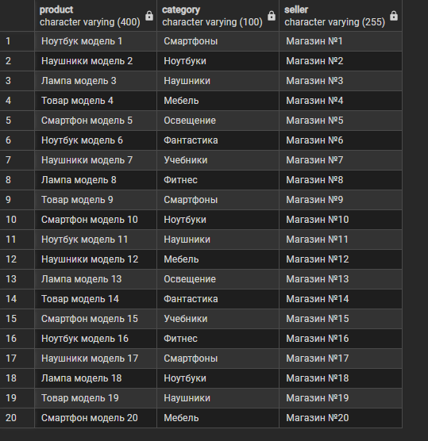

На скриншоте показаны 20 товаров с названиями категорий и магазинов, полученными по связям между таблицами.

## 2. Поиск товаров без отзывов

**Задача:** найти товары, для которых в таблице `reviews` нет ни одного отзыва.

### SQL-запрос

```sql
SELECT
    p.id,
    p.title,
    r.score
FROM products AS p
LEFT JOIN reviews AS r
    ON p.id = r.product_id
WHERE r.id IS NULL
LIMIT 20;
```

### Описание

`LEFT JOIN` сохраняет товары даже при отсутствии связанных отзывов. Для таких строк значения столбцов `r` становятся `NULL`.

Условие `WHERE r.id IS NULL` отбирает только товары без соответствий. Проверяется первичный ключ отзыва, который в существующей записи не может содержать `NULL`.

### Результат выполнения

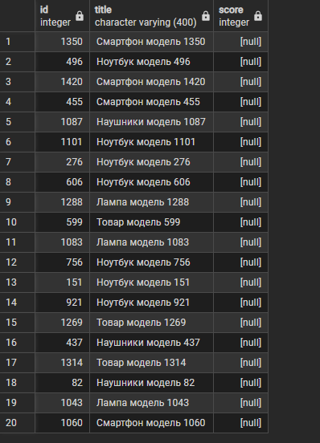

Все 20 показанных строк имеют `score = NULL`, поскольку отзыв отсутствует. Это не отзыв без оценки: поле `reviews.score` в исходной схеме объявлено `NOT NULL`.

По формулам генератора 900 отзывов относятся к 900 различным товарам, поэтому без отзывов остаются 600 из 1500 товаров. На скриншоте показан только ограниченный фрагмент.

## 3. Группировка и агрегатные функции

**Задача:** получить количество товаров и среднюю цену по категориям.

### SQL-запрос

```sql
SELECT
    c.name AS category,
    COUNT(p.id) AS product_count,
    ROUND(AVG(p.price), 2) AS average_price
FROM categories AS c
LEFT JOIN products AS p
    ON p.category_id = c.id
GROUP BY c.id, c.name
ORDER BY product_count DESC, c.id;
```

### Описание

`LEFT JOIN` сохраняет все категории, включая категории без непосредственно привязанных товаров. `GROUP BY c.id, c.name` формирует отдельную группу для каждой категории. Идентификатор в группировке предотвращает объединение разных категорий с одинаковыми названиями.

- `COUNT(p.id)` подсчитывает товары в группе и возвращает 0 для категории без товаров.
- `AVG(p.price)` вычисляет среднюю цену.
- `ROUND(..., 2)` округляет среднее до двух знаков после запятой.

Результат сортируется по убыванию количества товаров, затем по идентификатору категории при равных количествах.

### Результат выполнения

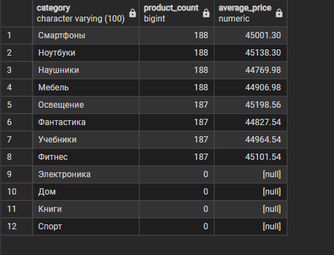

| Категория | Количество товаров | Средняя цена |
|---|---:|---:|
| Смартфоны | 188 | 45001.30 |
| Ноутбуки | 188 | 45138.30 |
| Наушники | 188 | 44769.98 |
| Мебель | 188 | 44906.98 |
| Освещение | 187 | 45198.56 |
| Фантастика | 187 | 44827.54 |
| Учебники | 187 | 44964.54 |
| Фитнес | 187 | 45101.54 |
| Электроника | 0 | NULL |
| Дом | 0 | NULL |
| Книги | 0 | NULL |
| Спорт | 0 | NULL |

В результате представлены все 12 категорий. Сумма количеств составляет 1500. Для четырёх корневых категорий без непосредственно привязанных товаров количество равно 0, а средняя цена — `NULL`. Подсчёт выполняется по прямой связи `products.category_id` с категорией.

## 4. Фильтрация групп с помощью HAVING

**Задача:** вывести продавцов с суммарной стоимостью позиций заказов более 6450000 условных денежных единиц.

### SQL-запрос

```sql
SELECT
    s.store_name AS seller,
    SUM(oi.quantity * oi.unit_price) AS revenue
FROM sellers AS s
INNER JOIN products AS p
    ON p.seller_id = s.id
INNER JOIN order_items AS oi
    ON oi.product_id = p.id
GROUP BY s.id, s.store_name
HAVING SUM(oi.quantity * oi.unit_price) > 6450000
ORDER BY revenue DESC
LIMIT 20;
```

### Описание

Последовательное соединение `sellers`, `products` и `order_items` связывает продавца с позициями заказов его товаров.

Для каждой позиции вычисляется `quantity * unit_price`. Используется цена `unit_price`, сохранённая на момент заказа, а не текущая цена карточки товара. `SUM` складывает стоимости позиций по продавцу, а `HAVING` отбирает группы после агрегации.

### Результат выполнения

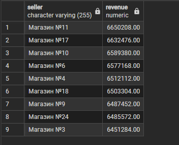

Наибольшее значение показано у магазина №11: **6650208.00**. Далее идут магазин №17 с **6632476.00** и магазин №10 с **6589380.00**.

Условие `HAVING` оставляет 9 из 25 продавцов. Последняя строка результата — магазин №3 с суммой **6451284.00**. Магазин №7 с суммой **6447996.00** уже не проходит заданный порог.

Показатель `revenue` рассчитывается как суммарная стоимость позиций заказов по товарам продавца. Такое же определение показателя используется в задании 6.1 и представлении `seller_revenue_report`.

## 5. Подзапросы

### 5.1. Скалярный подзапрос

**Задача:** выбрать товары дороже средней цены по всему каталогу.

```sql
SELECT
    p.title,
    p.price
FROM products AS p
WHERE p.price > (
    SELECT AVG(price)
    FROM products
)
ORDER BY p.price DESC
LIMIT 20;
```

Подзапрос возвращает одно значение `AVG(price)`, с которым сравнивается цена каждого товара. Он не ссылается на внешний запрос и является некоррелированным.

По генератору средняя цена составляет **44988.50**. В выборку попадают товары с большей ценой, отсортированные по убыванию.

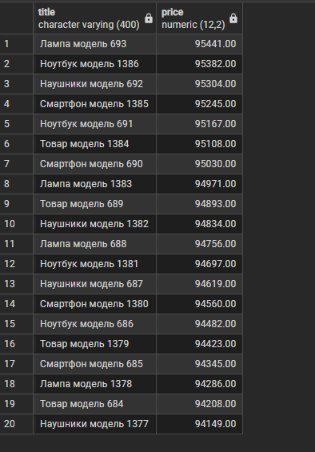

На скриншоте показаны 20 наиболее дорогих товаров. Максимальная цена — **95441.00** у товара «Лампа модель 693»; все показанные цены превышают среднюю.

### 5.2. Подзапрос с IN

**Задача:** вывести товары продавцов, название магазина которых оканчивается на «№5».

```sql
SELECT
    p.title,
    p.price,
    p.seller_id
FROM products AS p
WHERE p.seller_id IN (
    SELECT s.id
    FROM sellers AS s
    WHERE s.store_name ILIKE '%№5'
)
LIMIT 15;
```

Внутренний запрос находит идентификаторы магазинов по шаблону `ILIKE '%№5'`. Символ `%` допускает произвольное начало строки; после цифры 5 дополнительных символов быть не должно. `IN` проверяет принадлежность `seller_id` полученному набору.

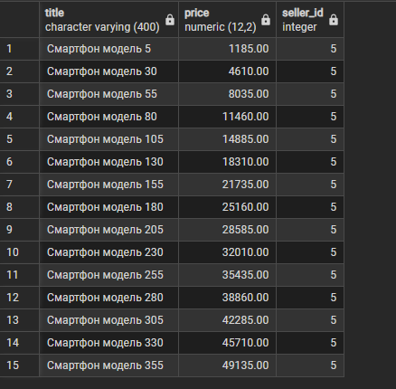

В данном наборе шаблону соответствует только «Магазин №5», поэтому все 15 показанных товаров имеют `seller_id = 5`. Например, цена «Смартфон модель 5» равна **1185.00**.

### 5.3. Коррелированный подзапрос с EXISTS

**Задача:** найти продавцов, у которых есть хотя бы один товар.

```sql
SELECT
    s.id,
    s.store_name
FROM sellers AS s
WHERE EXISTS (
    SELECT 1
    FROM products AS p
    WHERE p.seller_id = s.id
)
LIMIT 15;
```

Подзапрос ссылается на `s.id` внешнего запроса и является коррелированным. `EXISTS` проверяет наличие хотя бы одной связанной строки. Выражение `SELECT 1` подчёркивает, что значения столбцов товара для проверки не нужны.

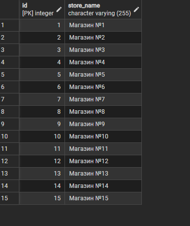

На скриншоте показаны магазины №1–15. Генератор назначает каждому из 25 продавцов по 60 товаров, поэтому условие истинно для всех; показанные 15 строк обусловлены `LIMIT`.

## 6. Общие табличные выражения

### 6.1. CTE для расчёта суммы по продавцам

**Задача:** разделить агрегацию позиций заказов и отбор продавцов на два этапа.

```sql
WITH seller_revenue AS (
    SELECT
        p.seller_id,
        SUM(oi.quantity * oi.unit_price) AS revenue
    FROM products AS p
    INNER JOIN order_items AS oi
        ON p.id = oi.product_id
    GROUP BY p.seller_id
)
SELECT
    s.store_name AS seller,
    sr.revenue
FROM seller_revenue AS sr
INNER JOIN sellers AS s
    ON sr.seller_id = s.id
WHERE sr.revenue > 100000
ORDER BY sr.revenue DESC
LIMIT 15;
```

CTE `seller_revenue` вычисляет сумму позиций заказов для каждого `seller_id`. Основной запрос присоединяет название магазина, фильтрует уже вычисленную сумму через `WHERE` и сортирует результат.

В задании 4 агрегат вычислялся в том же запросе, поэтому фильтрация групп выполнялась через `HAVING`. Здесь `sr.revenue` — готовый столбец промежуточного результата, доступный условию `WHERE`.

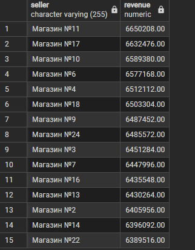

На скриншоте представлены 15 продавцов с наибольшими суммами позиций заказов. Здесь применяется порог 100000 и ограничение `LIMIT 15`. Первые 9 строк соответствуют продавцам из задания 4; далее показаны ещё 6 продавцов с суммами ниже порога 6450000, установленного в задании 4.

### 6.2. Рекурсивный CTE для дерева категорий

**Задача:** вывести категорию «Электроника» с идентификатором 1 и все её подкатегории с указанием глубины.

```sql
WITH RECURSIVE category_tree AS (
    SELECT
        id,
        name,
        parent_id,
        0 AS depth
    FROM categories
    WHERE id = 1

    UNION ALL

    SELECT
        c.id,
        c.name,
        c.parent_id,
        ct.depth + 1
    FROM categories AS c
    INNER JOIN category_tree AS ct
        ON c.parent_id = ct.id
)
SELECT
    id,
    name,
    parent_id,
    depth
FROM category_tree
ORDER BY depth, id
LIMIT 20;
```

Начальная часть выбирает категорию `id = 1` и задаёт глубину 0. Рекурсивная часть находит строки, у которых `parent_id` равен идентификатору уже найденной категории, увеличивая глубину на единицу. `UNION ALL` объединяет начальные и последующие уровни обхода.

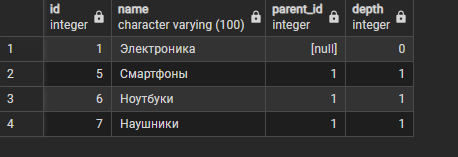

Получено четыре строки: «Электроника» на глубине 0, «Смартфоны», «Ноутбуки» и «Наушники» на глубине 1. Результат содержит поддерево категории с идентификатором 1, упорядоченное по глубине и идентификатору.

## 7. Аналитические представления

### 7.1. Статистика категорий

**Задача:** создать представление `category_statistics` с количеством товаров и средней ценой по всем категориям, включая категории без товаров.

```sql
CREATE OR REPLACE VIEW category_statistics AS
SELECT
    c.name AS category,
    COUNT(p.id) AS product_count,
    ROUND(AVG(p.price), 2) AS average_price
FROM categories AS c
LEFT JOIN products AS p
    ON p.category_id = c.id
GROUP BY c.id, c.name;
```

`CREATE OR REPLACE VIEW` создаёт представление или заменяет его определение при совместимой структуре столбцов.

**Результат создания:**

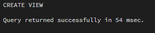

**Обращение к представлению:**

```sql
SELECT *
FROM category_statistics
ORDER BY product_count DESC, category
LIMIT 20;
```

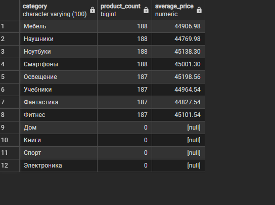

Представление возвращает все 12 категорий благодаря `LEFT JOIN`. Для категорий «Дом», «Книги», «Спорт» и «Электроника» количество товаров равно 0, а средняя цена — `NULL`. Значения количества и средней цены по каждой категории совпадают с результатом задания 3.

При обращении к представлению строки сортируются по убыванию количества товаров, а при равных количествах — по названию категории. Поэтому порядок строк отличается от задания 3, где дополнительным критерием служит идентификатор категории.

### 7.2. Сумма позиций заказов по продавцам

**Задача:** сохранить агрегат по продавцам под именем `seller_revenue_report`.

```sql
CREATE OR REPLACE VIEW seller_revenue_report AS
SELECT
    s.id AS seller_id,
    s.store_name AS seller,
    SUM(oi.quantity * oi.unit_price) AS revenue
FROM sellers AS s
INNER JOIN products AS p
    ON p.seller_id = s.id
INNER JOIN order_items AS oi
    ON oi.product_id = p.id
GROUP BY s.id, s.store_name;
```

Представление возвращает идентификатор продавца, название магазина и сумму стоимости позиций его товаров во всех заказах. Порог фильтрации не включён в определение, поэтому при обращении можно задавать разные условия.

**Результат создания:**

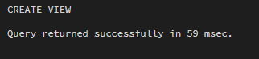

**Обращение к представлению:**

```sql
SELECT *
FROM seller_revenue_report
WHERE revenue > 100000
ORDER BY revenue DESC
LIMIT 20;
```

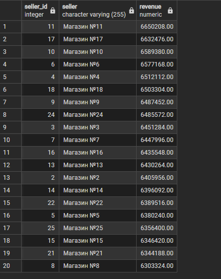

Запрос выводит 20 продавцов с наибольшими суммами позиций заказов при пороге 100000. Первые 15 строк совпадают с результатом задания 6.1, а первые 9 — с результатом задания 4, где установлен порог 6450000. Дополнительно выведен `seller_id`, позволяющий различать продавцов с одинаковым названием магазина.

Оба объекта являются обычными представлениями: они хранят определения запросов, а не отдельные копии результатов. При обращении используются данные исходных таблиц, видимые текущему запросу. Порядок строк задаётся в запросах к представлениям.

## Вывод

В ходе лабораторной работы №3 применены внутреннее и внешнее соединения таблиц, агрегатные функции, группировка, фильтрация групп, три вида подзапросов, обычный и рекурсивный CTE. Созданы два аналитических представления и продемонстрированы обращения к ним.

Выполнены запросы к связанным таблицам, получена статистика по всем 12 категориям, отобраны продавцы по агрегированному показателю и построено поддерево категории «Электроника». Для повторного использования аналитических запросов созданы представления `category_statistics` и `seller_revenue_report`. Тексты запросов, пояснения и 13 скриншотов результатов представлены в отчёте.
