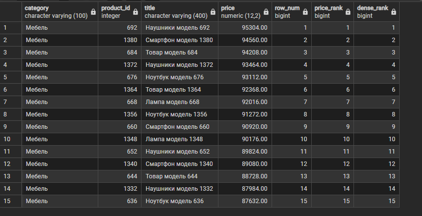
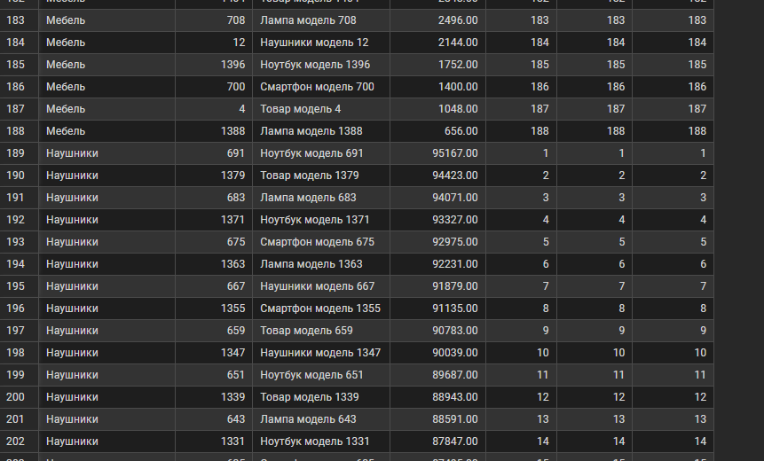
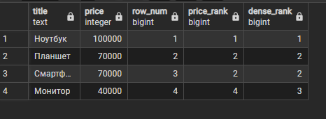
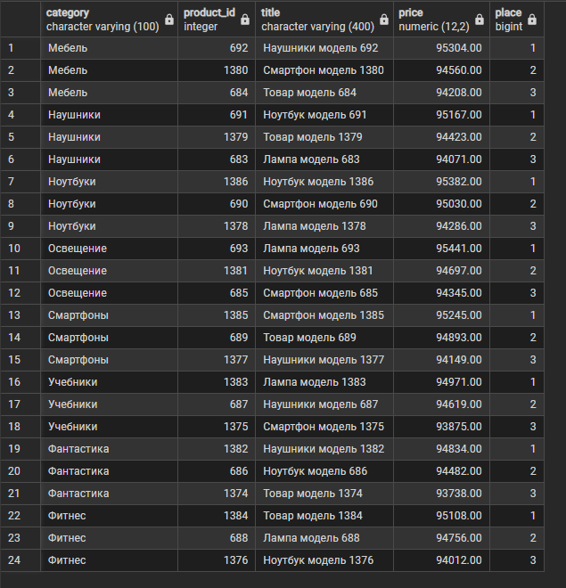
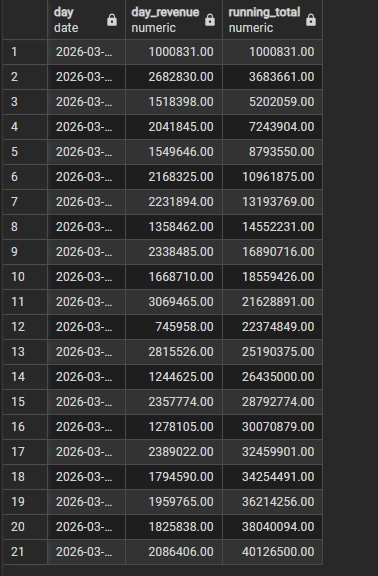
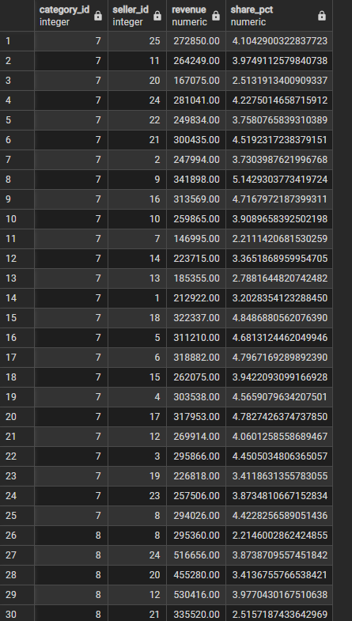
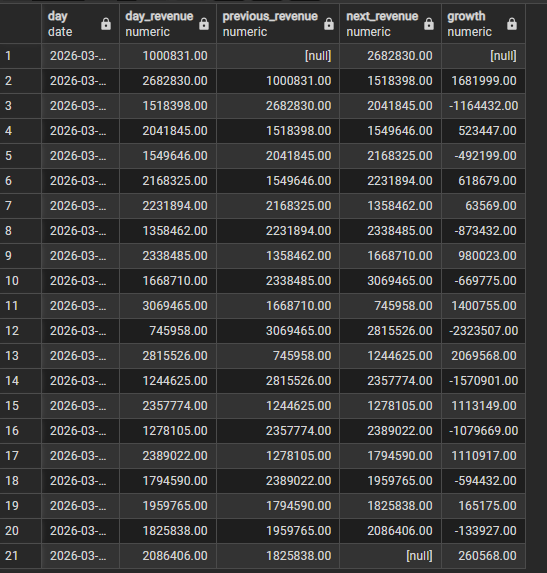
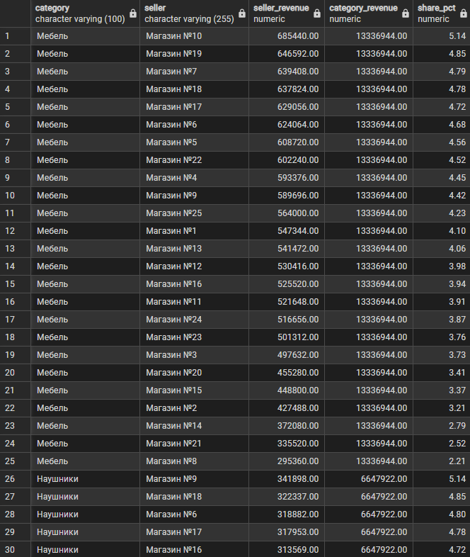

# Лабораторная работа №4 — Оконные функции и аналитика данных

**Дисциплина:** Математические основы баз данных  
**Предметная область:** Маркетплейс  
**СУБД:** PostgreSQL  
**Инструмент:** pgAdmin 4  
**Автор:** Провкин Алексей Сергеевич, БВТ2502  
**Год:** 2026

## Содержание

1. [Цель работы](#цель-работы)
2. [Исходные данные](#исходные-данные)
3. [Ранжирование товаров по цене](#1-ранжирование-товаров-по-цене)
4. [Три самых дорогих товара в каждой категории](#2-три-самых-дорогих-товара-в-каждой-категории)
5. [Нарастающий итог выручки по дням](#3-нарастающий-итог-выручки-по-дням)
6. [Доля выручки продавца в категории](#4-доля-выручки-продавца-в-категории)
7. [Сравнение выручки соседних дней](#5-сравнение-выручки-соседних-дней)
8. [Сравнение оконной функции и группировки](#6-сравнение-оконной-функции-и-группировки)
9. [Вывод](#вывод)

## Цель работы

Освоить оконные функции PostgreSQL на данных маркетплейса. Построить рейтинг товаров внутри категорий, выбрать по три самых дорогих товара, рассчитать накопленную выручку и изменение выручки между днями, а также сравнить два способа расчёта доли продавца в выручке категории.

## Исходные данные

Используется база данных из [лабораторной работы №1](../lab_work1/README.md), наполненная тестовыми данными в [лабораторной работе №2](../lab_work2/README.md).

Для воспроизведения результатов в учебной базе последовательно выполняются [marketplace.sql](../lab_work1/marketplace.sql), [seed_AI_GENERATED.sql](../lab_work2/seed_AI_GENERATED.sql) и [queries.sql](queries.sql).

В тестовом наборе 1500 товаров, 25 продавцов, 12 категорий, 1200 заказов и 2400 позиций заказов. Товары распределены по восьми дочерним категориям. В заданиях 3–6 выручка рассчитывается как сумма `quantity * unit_price` по позициям завершённых заказов (`status = 'completed'`). Для дневных показателей используется дата создания заказа по московскому времени.

## 1. Ранжирование товаров по цене

**Задача:** построить рейтинг товаров внутри каждой категории и сравнить результаты `ROW_NUMBER`, `RANK` и `DENSE_RANK` при одинаковых ценах.

### Рейтинг по категориям

```sql
SELECT
    c.name AS category,
    p.id AS product_id,
    p.title,
    p.price,
    ROW_NUMBER() OVER w AS row_num,
    RANK() OVER w AS price_rank,
    DENSE_RANK() OVER w AS dense_rank
FROM products AS p
JOIN categories AS c ON c.id = p.category_id
WINDOW w AS (
    PARTITION BY p.category_id
    ORDER BY p.price DESC
)
ORDER BY c.name, p.price DESC, p.id;
```

`PARTITION BY p.category_id` создаёт отдельное окно для каждой категории. `ORDER BY p.price DESC` внутри окна задаёт места по убыванию цены. Внешняя сортировка задаёт порядок показа строк. `LIMIT 15` оставляет первые 15 строк уже рассчитанного рейтинга.



На первой строке показан товар №692 с ценой 95 304,00. Для просмотра перехода между категориями запрос выполняется без `LIMIT 15`. Последний товар категории «Мебель» имеет место 188, а первый товар категории «Наушники» получает место 1 во всех трёх столбцах.



### Ранжирование при одинаковых ценах

```sql
WITH demo(title, price) AS (
    VALUES
        ('Ноутбук', 100000),
        ('Смартфон', 70000),
        ('Планшет', 70000),
        ('Монитор', 40000)
)
SELECT
    title,
    price,
    ROW_NUMBER() OVER (ORDER BY price DESC, title) AS row_num,
    RANK() OVER (ORDER BY price DESC) AS price_rank,
    DENSE_RANK() OVER (ORDER BY price DESC) AS dense_rank
FROM demo
ORDER BY row_num;
```



У планшета и смартфона одинаковая цена 70 000. `ROW_NUMBER` присваивает им разные номера 2 и 3, используя название товара как дополнительный критерий. `RANK` и `DENSE_RANK` присваивают обоим товарам ранг 2. Следующий товар получает ранг 4 по `RANK` и ранг 3 по `DENSE_RANK`.

## 2. Три самых дорогих товара в каждой категории

**Задача:** вывести до трёх товаров с наибольшей ценой из каждой категории.

```sql
WITH ranked_products AS (
    SELECT
        c.id AS category_id,
        c.name AS category,
        p.id AS product_id,
        p.title,
        p.price,
        ROW_NUMBER() OVER (
            PARTITION BY p.category_id
            ORDER BY p.price DESC NULLS LAST, p.id
        ) AS place
    FROM products AS p
    JOIN categories AS c ON c.id = p.category_id
)
SELECT category, product_id, title, price, place
FROM ranked_products
WHERE place <= 3
ORDER BY category, category_id, place;
```

CTE `ranked_products` нумерует товары по убыванию цены отдельно в каждой категории. При равных ценах раньше идёт товар с меньшим идентификатором. Внешний запрос применяет условие `place <= 3` к уже вычисленным номерам.



Получено 24 строки. Например, в категории «Мебель» первые три места заняли товары №692, №1380 и №684 с ценами 95 304,00, 94 560,00 и 94 208,00 соответственно.

## 3. Нарастающий итог выручки по дням

**Задача:** для каждого дня вывести дневную выручку и её накопленную сумму с начала периода.

```sql
WITH daily AS (
    SELECT
        (o.created_at AT TIME ZONE 'Europe/Moscow')::date AS day,
        SUM(oi.quantity * oi.unit_price) AS day_revenue
    FROM orders AS o
    JOIN order_items AS oi ON oi.order_id = o.id
    WHERE o.status = 'completed'
    GROUP BY 1
)
SELECT
    day,
    day_revenue,
    SUM(day_revenue) OVER (
        ORDER BY day
        ROWS BETWEEN UNBOUNDED PRECEDING AND CURRENT ROW
    ) AS running_total
FROM daily
ORDER BY day;
```

CTE `daily` группирует позиции завершённых заказов по дате и вычисляет `day_revenue`. Оконная функция `SUM` складывает дневные суммы от первой строки до текущей включительно. Эти границы задаёт рамка `ROWS BETWEEN UNBOUNDED PRECEDING AND CURRENT ROW`.



За 1 марта выручка составила 1 000 831,00. С учётом 2 марта накопленная сумма достигла 3 683 661,00. Итог за период с 1 по 21 марта 2026 года составил 40 126 500,00.

## 4. Доля выручки продавца в категории

**Задача:** определить, какой процент выручки категории приходится на каждого продавца с завершёнными продажами в этой категории.

```sql
WITH seller_sales AS (
    SELECT
        p.category_id,
        p.seller_id,
        SUM(oi.quantity * oi.unit_price) AS revenue
    FROM orders AS o
    JOIN order_items AS oi ON oi.order_id = o.id
    JOIN products AS p ON p.id = oi.product_id
    WHERE o.status = 'completed'
    GROUP BY p.category_id, p.seller_id
)
SELECT
    category_id,
    seller_id,
    revenue,
    100 * revenue / NULLIF(SUM(revenue) OVER (PARTITION BY category_id),
    0
    ) AS share_pct
FROM seller_sales;
```

CTE `seller_sales` вычисляет выручку для каждой пары «категория — продавец». Оконная сумма `SUM(revenue) OVER (PARTITION BY category_id)` даёт общий итог категории в каждой строке продавца. Доля получается делением выручки продавца на итог категории и умножением на 100. Если итог равен нулю, `NULLIF` возвращает `NULL` для знаменателя и предотвращает деление на ноль.



Например, продавец с идентификатором 25 в категории №7 («Наушники») получил выручку 272 850,00, что составляет около 4,10 % от выручки категории.

## 5. Сравнение выручки соседних дней

**Задача:** показать выручку предыдущего и следующего дня и вычислить абсолютное изменение относительно предыдущего дня.

```sql
WITH daily AS (
    SELECT
        (o.created_at AT TIME ZONE 'Europe/Moscow')::date AS day,
        SUM(oi.quantity * oi.unit_price) AS day_revenue
    FROM orders AS o
    JOIN order_items AS oi ON oi.order_id = o.id
    WHERE o.status = 'completed'
    GROUP BY 1
)
SELECT
    day,
    day_revenue,
    LAG(day_revenue) OVER (ORDER BY day) AS previous_revenue,
    LEAD(day_revenue) OVER (ORDER BY day) AS next_revenue,
    day_revenue - LAG(day_revenue) OVER (ORDER BY day) AS growth
FROM daily
ORDER BY day;
```

Функции `LAG` и `LEAD` получают выручку из предыдущей и следующей строк в порядке дат. Прирост `growth` равен разности между текущей и предыдущей выручкой. В тестовом периоде выручка есть за каждый день, поэтому соседние строки соответствуют соседним календарным дням.



За 2 марта выручка выросла на 1 681 999,00, а за 3 марта снизилась на 1 164 432,00. Для первой строки предыдущая выручка и прирост равны `NULL`. Для последней строки `NULL` возвращает `LEAD`.

## 6. Сравнение оконной функции и группировки

**Задача:** повторить расчёт доли продавца из задания 4 с помощью обычной группировки и сравнить оба способа.

```sql
WITH seller_sales AS (
    SELECT
        p.category_id,
        p.seller_id,
        SUM(oi.quantity * oi.unit_price) AS seller_revenue
    FROM orders AS o
    JOIN order_items AS oi ON oi.order_id = o.id
    JOIN products AS p ON p.id = oi.product_id
    WHERE o.status = 'completed'
    GROUP BY p.category_id, p.seller_id
),
category_totals AS (
    SELECT category_id, SUM(seller_revenue) AS category_revenue
    FROM seller_sales
    GROUP BY category_id
)
SELECT
    c.name AS category,
    s.store_name AS seller,
    ss.seller_revenue,
    ct.category_revenue,
    ROUND(100.0 * ss.seller_revenue / NULLIF(ct.category_revenue, 0), 2) AS share_pct
FROM seller_sales AS ss
JOIN category_totals AS ct ON ct.category_id = ss.category_id
JOIN categories AS c ON c.id = ss.category_id
JOIN sellers AS s ON s.id = ss.seller_id
ORDER BY c.name, c.id, ss.seller_revenue DESC, s.id;
```

Оба запроса сначала вычисляют выручку каждой пары «категория — продавец». В задании 4 оконная сумма сразу добавляет итог категории к каждой строке продавца. При группировке `category_totals` формирует отдельный набор с одной строкой на категорию. Для расчёта доли этот набор присоединяется к выручке продавцов по `category_id`. В итоговой выборке также выведены названия категорий и магазинов, а проценты округлены до двух знаков.



В категории «Мебель» выручка магазина №10 составила 685 440,00 при общем итоге категории 13 336 944,00. Его доля равна 5,14 %. Для продавца №25 в категории «Наушники» расчёт даёт те же 4,10 % после округления, что и в задании 4. Оконная функция удобна для этого отчёта, поскольку сохраняет строки продавцов и предоставляет итог категории без отдельной группировки и соединения по `category_id`.

## Вывод

В PostgreSQL построен рейтинг товаров по категориям, показано поведение ранжирующих функций при равных ценах и отобраны три самых дорогих товара из каждой заполненной категории. Рассчитаны накопленная выручка по дням и её изменение относительно предыдущего дня. Доля выручки продавца в категории получена двумя способами: оконной суммой и группировкой с последующим соединением.
